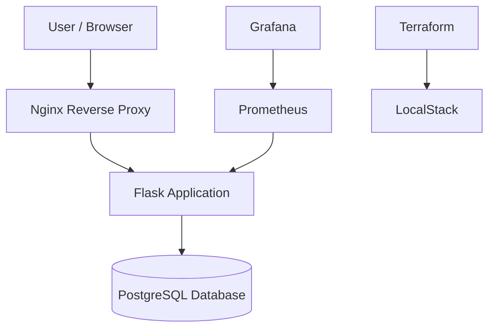

# Enterprise Multi-Tier Cloud Infrastructure

A locally simulated, multi-tier cloud infrastructure project demonstrating Infrastructure as Code, network segmentation, containerized application deployment, database isolation, reverse proxy configuration, and centralized monitoring.

## Project Overview

This project builds an enterprise-style infrastructure environment using Terraform, LocalStack, Docker Compose, Flask, PostgreSQL, Nginx, Prometheus, and Grafana.

It demonstrates how application, database, and monitoring components communicate through segmented Docker networks while exposing only selected services through localhost-bound ports.

**Important:** AWS infrastructure is simulated locally through LocalStack. No real AWS resources are created by this project.

## Architecture



## Technology Stack

| Component | Technology |
|---|---|
| Infrastructure as Code | Terraform |
| AWS API Simulation | LocalStack |
| Containerization | Docker |
| Orchestration | Docker Compose |
| Reverse Proxy | Nginx |
| Backend | Python, Flask |
| Database | PostgreSQL |
| Metrics Collection | Prometheus |
| Monitoring Dashboard | Grafana |
| Automated Testing | Pytest |

## Key Features

- Multi-tier application architecture.
- Terraform-based AWS-style infrastructure provisioning against LocalStack.
- Public, application, database, and monitoring network segmentation.
- Nginx reverse proxy for application traffic.
- PostgreSQL database connectivity and health checks.
- Prometheus application metrics collection.
- Grafana monitoring dashboard.
- Automated endpoint tests using Pytest.
- Database failure and recovery testing.
- Restricted host port exposure and internal Docker networks.
- Nginx blocks direct HTTP access to the application metrics endpoint.

## Network Design

| Network | Components | Purpose |
|---|---|---|
| public_net | Nginx, Prometheus, Grafana | Selected host-accessible services |
| app_net | Flask, Nginx, Prometheus | Application communication |
| data_net | Flask, PostgreSQL | Database communication |
| monitoring_net | Prometheus, Grafana | Monitoring communication |
| aws_sim_net | LocalStack | AWS API simulation |

The application, data, and monitoring networks are configured as internal Docker networks.

## Security Implementation

- PostgreSQL has no published host port.
- Flask has no published host port.
- Selected service ports bind to `127.0.0.1`.
- Nginx returns HTTP 404 for `/metrics`.
- Prometheus scrapes application metrics directly over the Docker network.
- Database access is performed through the application tier.

## Testing and Verification

The following checks have been performed:

| Test | Verified result |
|---|---|
| Application health endpoint | HTTP 200 |
| Database health endpoint | HTTP 200 |
| Nginx metrics restriction | HTTP 404 |
| Endpoint test suite | 5 tests passed |
| Database network isolation | Internal network |
| Application network isolation | Internal network |
| Monitoring network isolation | Internal network |
| PostgreSQL host port | Not published |
| Flask host port | Not published |

## Local Setup

### Prerequisites

- Windows 10/11
- Docker Desktop with Docker Compose
- Terraform CLI
- AWS CLI (for LocalStack API interaction)
- Python 3

### Start the environment

Clone the repository:

```bash
git clone https://github.com/NamanPachauli/enterprise-multi-tier-cloud-infrastructure.git
cd enterprise-multi-tier-cloud-infrastructure
```

Start the Docker environment:

```bash
docker compose up -d --build
```

Check service status:

```bash
docker compose ps
```

### Access local services

| Service | Local URL |
|---|---|
| Application through Nginx | http://localhost:8086 |
| Application health | http://localhost:8086/health |
| Database health | http://localhost:8086/db-health |
| Prometheus | http://localhost:9095 |
| Grafana | http://localhost:3005 |
| LocalStack | http://localhost:4568 |

Grafana local development credentials:

- Username: `admin`
- Password: `local_admin_only`

These are demonstration credentials. Change them before any shared or production deployment.

### Run endpoint tests

```bash
python -m pytest tests/test_endpoints.py -v
```

### Stop the environment

```bash
docker compose down
```

## Project Structure

```text
enterprise-multi-tier-cloud-infrastructure/
├── terraform/
│   ├── modules/
│   └── environments/
├── app/
├── nginx/
├── tests/
├── monitoring/
│   └── prometheus/
├── scripts/
├── docs/
├── evidence/
├── localstack/
└── docker-compose.yml
```

## Learning Outcomes

- Multi-tier infrastructure design.
- Infrastructure as Code fundamentals.
- Docker networking and service isolation.
- Reverse proxy configuration.
- Application-to-database communication.
- Monitoring and metrics collection.
- Infrastructure testing and troubleshooting.
- Local AWS API simulation.

## Limitations

This project uses LocalStack and Docker for local development and simulation. It does not demonstrate a production deployment on actual AWS infrastructure. AWS service behavior and feature coverage may differ from real AWS.

## Author

**Naman Pachauli**

GitHub: [NamanPachauli](https://github.com/NamanPachauli)