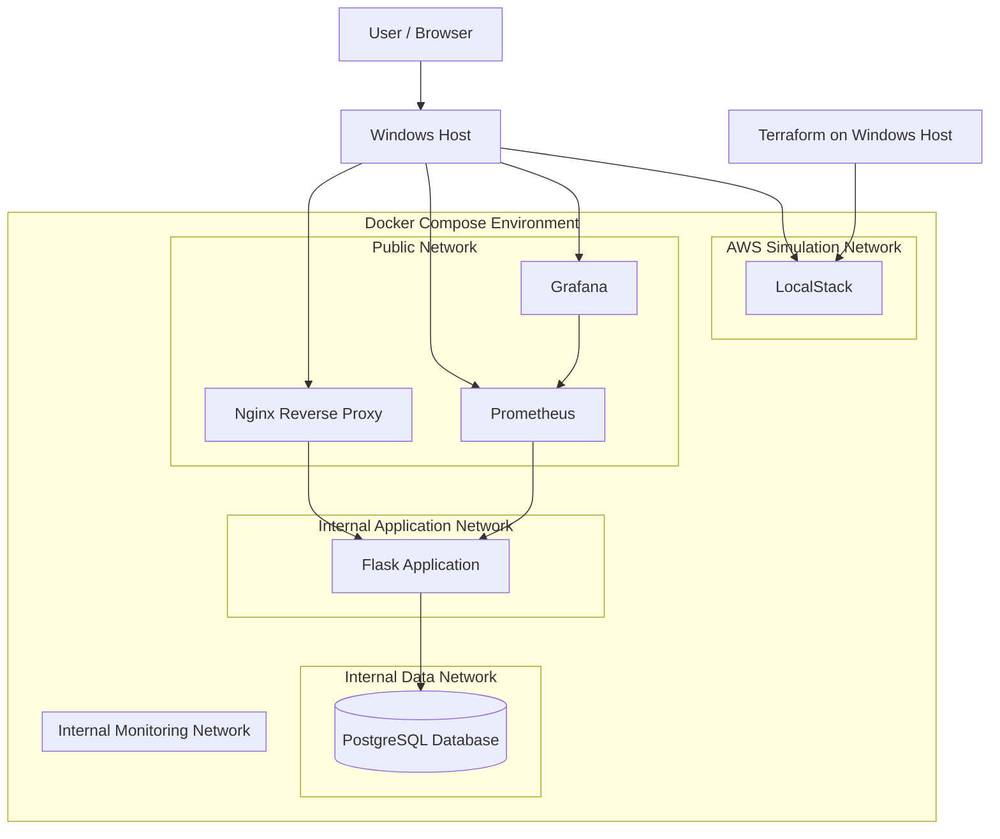

# Enterprise Multi-Tier Cloud Infrastructure

## 1. Project Overview

This project demonstrates a multi-tier cloud infrastructure environment using Docker Compose, Terraform, LocalStack, Flask, PostgreSQL, Nginx, Prometheus and Grafana.

The infrastructure is designed to demonstrate network segmentation, application isolation, database connectivity, monitoring and infrastructure provisioning.

All cloud infrastructure testing is performed locally using LocalStack. No real AWS resources are created.

## 2. Architecture Diagram

## 3. Application Request Flow

1. User sends an HTTP request to Nginx.
2. Nginx forwards permitted requests to the Flask application.
3. Flask processes the request.
4. Flask communicates with PostgreSQL over the internal data network.
5. The application returns the response through Nginx.

## 4. Monitoring Flow

1. Prometheus scrapes application metrics directly from `app:8080/metrics`.
2. Grafana connects to Prometheus as its data source.
3. Dashboards display application request counts, request rates, response times and health status.
4. Nginx blocks external access to the `/metrics` endpoint.

## 5. Network Segmentation

| Network | Connected components | Purpose |
|---|---|---|
| public_net | Nginx, Prometheus, Grafana | Host-accessible entry points |
| app_net | Flask, Nginx, Prometheus | Application communication |
| data_net | Flask, PostgreSQL | Database communication |
| monitoring_net | Prometheus, Grafana | Monitoring communication |
| aws_sim_net | LocalStack | AWS API simulation |

The `app_net`, `data_net` and `monitoring_net` Docker networks are configured as internal networks.

## 6. Infrastructure Provisioning

Terraform provisions AWS-style networking resources against LocalStack:

- VPC
- Public subnet
- Private application subnet
- Private database subnet
- Internet Gateway
- Route tables and associations
- Security groups

LocalStack simulates AWS APIs. These resources are not actual AWS infrastructure.

## 7. Security Controls

- PostgreSQL is not published to a host port.
- Flask application is not published to a host port.
- Nginx, Prometheus, Grafana and LocalStack use localhost-only host bindings.
- Nginx blocks `/metrics`.
- Docker networks provide service-level segmentation.
- Database access is limited to the application network.

## 8. Technology Stack

- Infrastructure as Code: Terraform
- AWS API Simulation: LocalStack
- Containers: Docker and Docker Compose
- Reverse Proxy: Nginx
- Backend: Python and Flask
- Database: PostgreSQL
- Monitoring: Prometheus
- Visualization: Grafana
- Testing: Pytest
